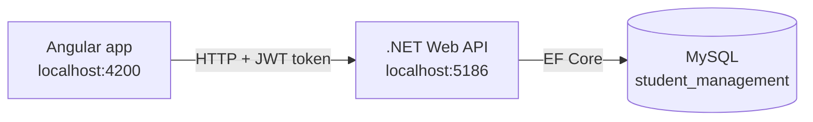

# CampusDesk – Student Management System

A web app for managing **students**, **courses** and **enrollments** in one place. It has an Angular frontend, a .NET 10 Web API backend and a MySQL database, with secure JWT login.


## Features

- Register and sign in with email and password
- Dashboard with totals and the 5 newest students
- Students: search, add, edit, delete
- Courses: add, edit, delete (with description, fees and enrollment count)
- Enrollments: enroll a student in a course, list and remove registrations
- Validation in the browser and again on the server
- Interactive API documentation (Scalar)

## Tech stack

| Part | Technology |
|---|---|
| Frontend | Angular 21, TypeScript, Bootstrap 5, RxJS |
| Backend | .NET 10, ASP.NET Core Web API, Entity Framework Core |
| Database | MySQL 8 |
| Security | JWT bearer tokens, hashed passwords (ASP.NET Core `PasswordHasher`), CORS |

## Architecture



The frontend and backend are separate projects. They only communicate through the API.

**Backend layers**

| Folder | Job |
|---|---|
| `Controllers/` | Receive HTTP requests and return responses |
| `DTOs/` | Validated request and response shapes |
| `Interfaces/` | Service contracts |
| `Services/` | Business rules and database operations |
| `Models/` | Database entities |
| `Data/` | `ApplicationDbContext`, design-time factory, migrations |
| `Options/` | JWT configuration validation |

**Frontend structure** (`frontend/src/app/`)

| Folder / file | Job |
|---|---|
| `pages/` | 8 screens: login, register, dashboard, student and course lists/forms, enrollments |
| `services/` | Typed HTTP and auth services, plus the auth interceptor |
| `auth.guard.ts` / `guest.guard.ts` | Protect pages and keep signed-in users off login/register |
| `environments/` | API URL configuration |

## Database

```
Students (Id, Name, Email*, Phone, DateOfBirth, CreatedAt)
Courses  (Id, CourseName, Description, Fees)
Enrollments (Id, StudentId -> Students, CourseId -> Courses, EnrollmentDate)
Users (Id, Email*, PasswordHash, CreatedAt)         * = unique
```

- A student can be enrolled in a course only once (unique StudentId + CourseId pair).
- Deleting a student or a course also deletes its enrollments.
- `Users` is used only for login and is not linked to students.

## How login works

1. A user registers (email + password of 8 to 128 characters). The password is stored only as a hash.
2. On login the API verifies the password and returns a JWT valid for 60 minutes.
3. The browser stores the token and an interceptor adds `Authorization: Bearer <token>` to every request.
4. All student, course and enrollment endpoints require a valid token. A missing or invalid token gets `401 Unauthorized`.

## API endpoints

Base URL: `http://localhost:5186/api`

| Area | Endpoints | Token |
|---|---|---|
| Auth | `POST /auth/register`, `POST /auth/login` | No |
| Students | `GET /students`, `GET /students/{id}`, `POST /students`, `PUT /students/{id}`, `DELETE /students/{id}` | Yes |
| Courses | `GET /courses`, `GET /courses/{id}`, `POST /courses`, `PUT /courses/{id}`, `DELETE /courses/{id}` | Yes |
| Enrollments | `GET /enrollments`, `POST /enrollments`, `DELETE /enrollments/{id}` | Yes |

Common responses: `201` created, `204` deleted, `404` not found, `409` conflict (duplicate email or duplicate enrollment), `401` unauthorized.

## Requirements

- .NET 10 SDK
- Node.js 20.19+ or 22.12+
- MySQL 8.0+
- EF Core CLI: `dotnet tool install --global dotnet-ef --version 10.0.14`

## Getting started

### 1. Create the database

```sql
CREATE DATABASE student_management;
```

### 2. Configure the backend

Set your MySQL connection string in `backend/StudentManagement.Api/appsettings.json`:

```json
"ConnectionStrings": {
  "DefaultConnection": "Server=localhost;Port=3306;Database=student_management;User=YOUR_USER;Password=YOUR_PASSWORD;"
}
```

> Never commit real passwords. Prefer user-secrets or environment variables, for example `ConnectionStrings__DefaultConnection`.

Create a JWT signing key (at least 32 characters) and keep it out of source control:

```powershell
$bytes = New-Object byte[] 48
$rng = [Security.Cryptography.RandomNumberGenerator]::Create()
$rng.GetBytes($bytes)
dotnet user-secrets set "Authentication:Jwt:Key" ([Convert]::ToBase64String($bytes)) --project backend\StudentManagement.Api\StudentManagement.Api.csproj
```

### 3. Create the tables and start the API

```powershell
dotnet ef database update --project backend\StudentManagement.Api\StudentManagement.Api.csproj --startup-project backend\StudentManagement.Api\StudentManagement.Api.csproj
dotnet run --project backend\StudentManagement.Api\StudentManagement.Api.csproj --launch-profile http
```

- API: http://localhost:5186
- Scalar docs: http://localhost:5186/scalar/v1
- OpenAPI JSON: http://localhost:5186/openapi/v1.json

### 4. Start the frontend

```powershell
cd frontend
npm install
npm start
```

Open http://localhost:4200, create an account on the register screen, then sign in. The API URL is set in `frontend/src/environments/environment.ts`.

## Useful commands

```powershell
# Build both projects
dotnet build backend\StudentManagement.Api\StudentManagement.Api.csproj
npm --prefix frontend run build

# Add a new migration after changing the models
dotnet ef migrations add MigrationName --project backend\StudentManagement.Api\StudentManagement.Api.csproj --startup-project backend\StudentManagement.Api\StudentManagement.Api.csproj --output-dir Data\Migrations
```

## Project structure

```
Student Managemnet System/
├── backend/
│   └── StudentManagement.Api/
│       ├── Controllers/  DTOs/  Interfaces/  Models/
│       ├── Options/  Services/  Data/
│       └── Program.cs
└── frontend/
    └── src/app/
        ├── pages/  services/  shared/
        └── app.routes.ts
```

## Known limitations and ideas

- All signed-in users share the same data (no per-user ownership or roles yet).
- The app does not automatically sign out or refresh the token when it expires after 60 minutes.
- No paging or export for long lists.
- No automated tests or Docker setup yet.
